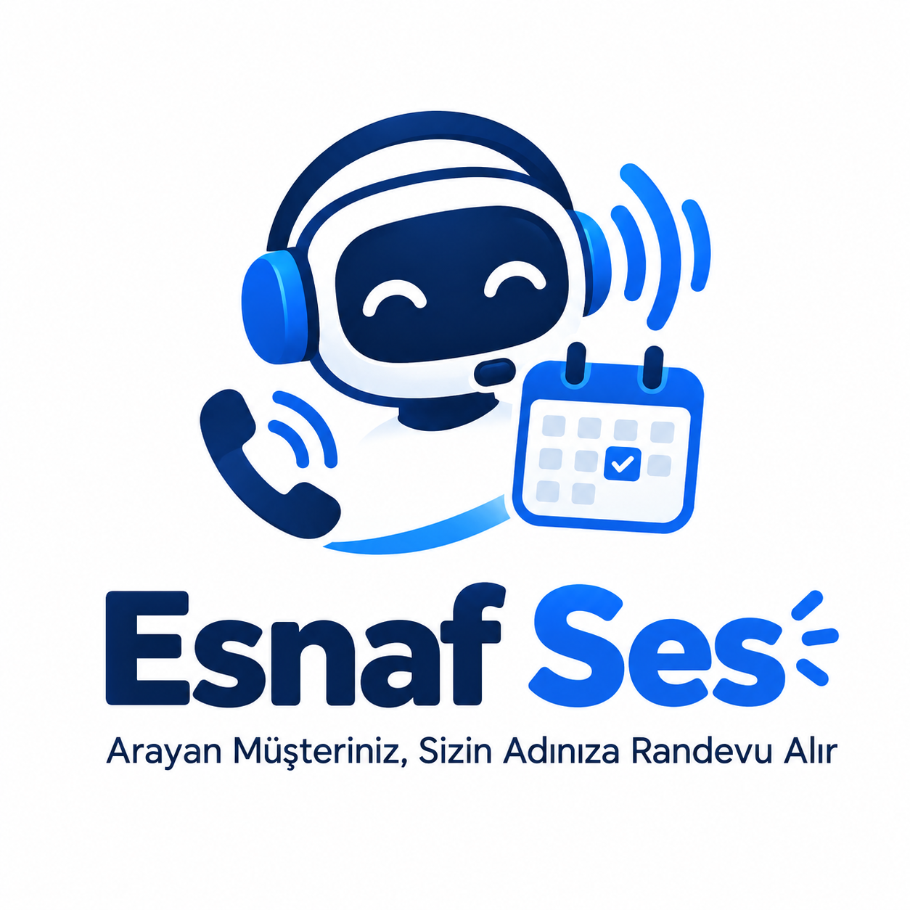
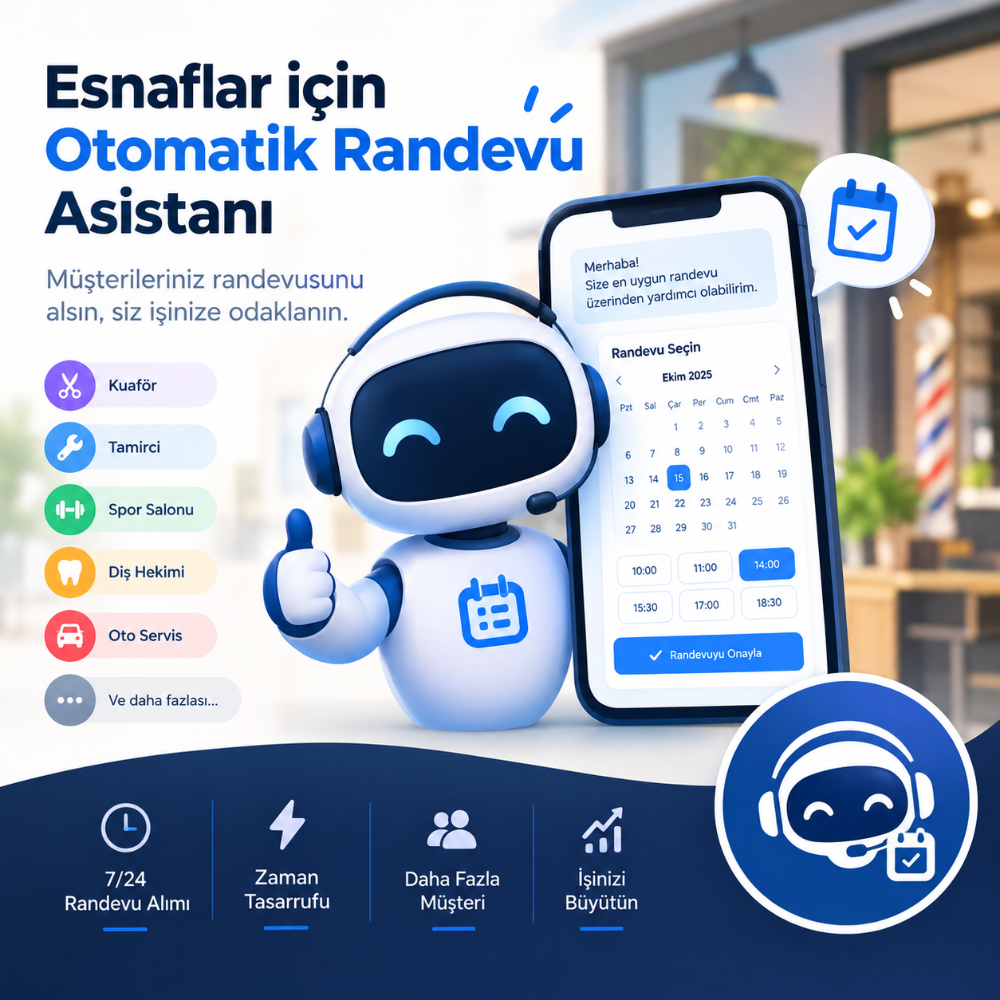
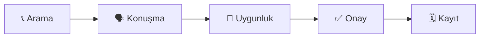

# Esnaf Ses

### Arayan müşteriniz, sizin adınıza randevu alır.

Esnaflar için Türkçe konuşan, cihazda çalışan **sesli randevu asistanı**. 
Müşterileriniz randevusunu alsın, siz işinize odaklanın.

 

  

---

## 📞 Esnaf Ses nedir?

Telefon çalar, siz müşterinizle ilgilenirken açamazsınız — randevu kaçar.
**Esnaf Ses** o aramayı sizin yerinize karşılar: müşteriyle doğal Türkçe konuşur, uygun gün ve saati bulur, özeti okur ve **müşteri onay verdikten sonra** randevuyu takviminize yazar.

| | |
|---|---|
| 🕒 **7/24 randevu alımı** | Mesai dışında ve yoğun saatlerde de çağrılar karşılanır. |
| ⚡ **Zaman tasarrufu** | Telefon trafiği yerine işinize odaklanırsınız. |
| 👥 **Daha fazla müşteri** | Cevapsız arama yüzünden kaçan randevu kalmaz. |
| 📈 **İşinizi büyütün** | Düzenli takvim, daha az boşluk, daha çok hizmet. |

## 🏪 Kimler için?

<table>
  <tr>
    <td align="center">✂️ <b>Kuaför</b></td>
    <td align="center">🔧 <b>Tamirci</b></td>
    <td align="center">🏋️ <b>Spor Salonu</b></td>
    <td align="center">🦷 <b>Diş Hekimi</b></td>
    <td align="center">🚗 <b>Oto Servis</b></td>
    <td align="center">➕ <b>Ve daha fazlası</b></td>
  </tr>
</table>

## 🔄 Nasıl çalışır?

1. **Arama** — Müşteri işletmenizi arar, Esnaf Ses karşılar.
2. **Konuşma** — Gün, saat ve isim doğal Türkçe konuşmayla alınır.
3. **Uygunluk** — Takvimde boş saat kontrol edilir, gerekirse alternatif önerilir.
4. **Onay** — Randevu özeti okunur, müşteri onaylar.
5. **Kayıt** — Randevu takviminize yazılır.

## 🛡️ İlkelerimiz

- **Onaysız kayıt yok.** Randevu, yalnız müşterinin açık onayından sonra yazılır; düzeltme eski onayı geçersiz kılar.
- **Uydurma yok.** Takvim ve kayıt sonuçları modelden değil, uygulama kodundan gelir.
- **Cihazda çalışır.** Konuşma çekirdeği yerelde çalışır; müşteri verisi gereksiz yere dışarı çıkmaz.
- **Saygılı ve kısa.** Varsayılan hitap "siz"; sıcak, ölçülü ve net bir işletme dili.

## 🧩 Mimari

| Bileşen | Görev |
|---|---|
| **Konuşma çekirdeği** | Türkçe niyet/alan modeli, yapılandırılmış hafıza, açık onaylı SQLite randevu defteri |
| **Uygulama** | Flutter ile esnaf sürümü, telefon testi ve Windows masaüstü |
| **Sunucu** | Telefon hattı için relay kurulumu (Docker, Caddy, systemd) |

---

**Esnaf Ses** — telefonunuz çalarken işiniz durmasın. 💙

Proje aktif geliştirme aşamasındadır.

